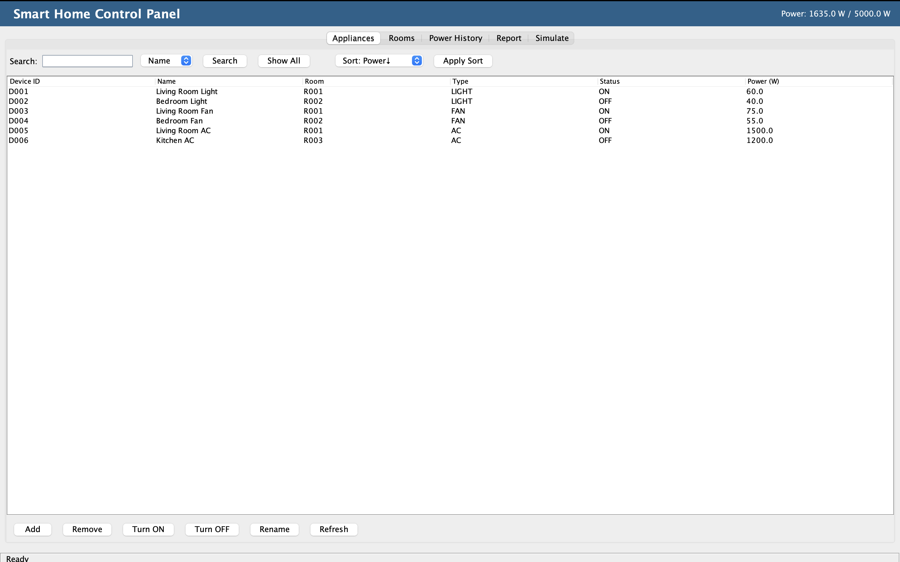
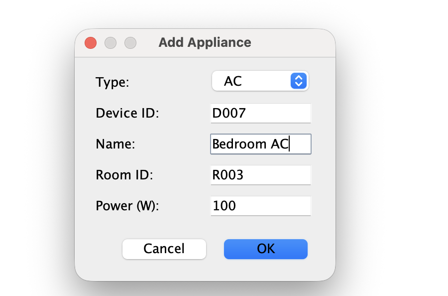
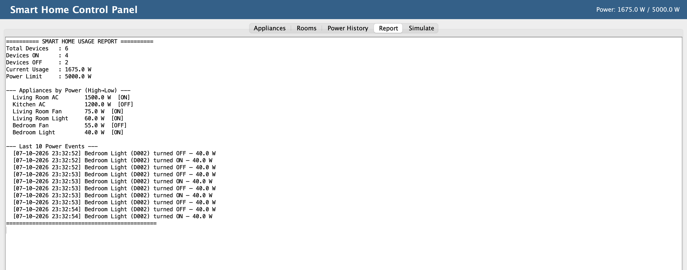
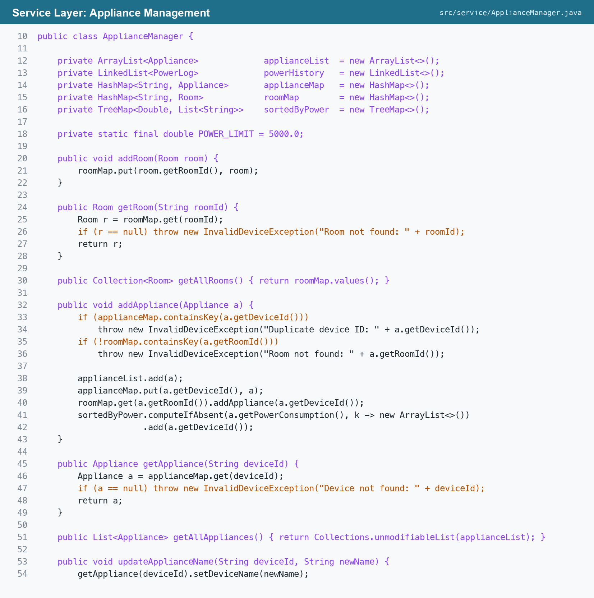
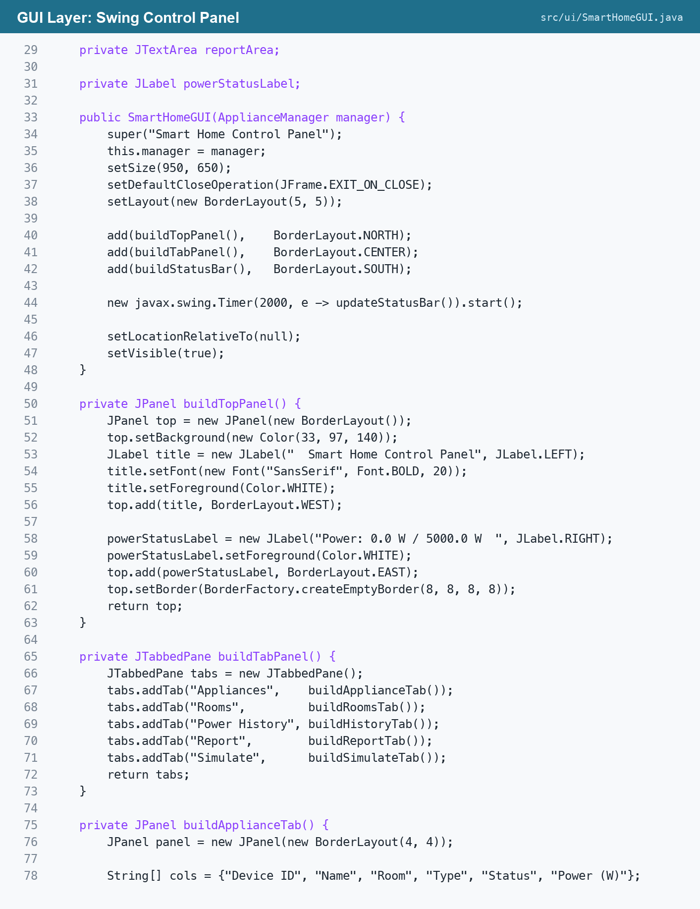

# Smart Home Appliance Control Simulator

Java Programming : a Swing-based simulator for controlling and monitoring smart home appliances such as lights, fans, and air conditioners.

## Problem Statement

A smart home platform needs a simulator to control and monitor household appliances remotely. The system tracks device on/off status, room mapping, power consumption, and simulated real-time state changes across multiple devices.

## Objectives

- Maintain appliance and room information.
- Control appliance on/off status remotely.
- Track power consumption per device.
- Simulate real-time appliance state changes.
- Search and sort appliance records.
- Provide a smart home control GUI.

## Features

- Appliance registration for lights, fans, and air conditioners.
- Room mapping with room-wise appliance listing.
- Remote on/off control from the GUI.
- Power usage validation with a 5000 W limit.
- Power event history using a linked list.
- Search by name, room, type, and status.
- Sorting by power consumption, name, and status.
- Runnable/thread-based state simulation.
- Usage report generation.
- Custom exception handling for invalid devices and power limit errors.

## Folder Structure

```text
SmartHomeSimulator/
|-- README.md
|-- run.sh
|-- src/
|   |-- app/
|   |   `-- Main.java
|   |-- exception/
|   |   |-- InvalidDeviceException.java
|   |   `-- PowerLimitExceededException.java
|   |-- model/
|   |   |-- AirConditioner.java
|   |   |-- Appliance.java
|   |   |-- Controllable.java
|   |   |-- Fan.java
|   |   |-- Light.java
|   |   |-- PowerLog.java
|   |   `-- Room.java
|   |-- service/
|   |   `-- ApplianceManager.java
|   |-- simulation/
|   |   `-- DeviceSimulator.java
|   `-- ui/
|       `-- SmartHomeGUI.java
`-- out/                         # Generated after compilation
```

## Package Responsibilities

| Package | Responsibility |
| --- | --- |
| `app` | Application entry point and sample data setup |
| `model` | Core entities such as appliances, rooms, logs, and control interface |
| `service` | Appliance CRUD, searching, sorting, validation, and reports |
| `simulation` | Runnable-based state change simulation |
| `ui` | Swing GUI for controlling and monitoring devices |
| `exception` | Custom exceptions for invalid operations |

## Java Concepts Covered

| Java Concept | Implementation |
| --- | --- |
| Classes and Objects | `Appliance`, `Room`, `PowerLog`, appliance subclasses |
| Constructors | Object initialization for rooms and appliances |
| Abstract Class | `Appliance` as the base class |
| Interface | `Controllable` for remote control behavior |
| Runnable/Thread | `DeviceSimulator` for concurrent state changes |
| ArrayList | Stores appliance records |
| LinkedList | Stores power usage history |
| HashMap | Maps device IDs and room IDs to objects |
| TreeMap | Maintains devices sorted by power consumption |
| CRUD | Add, update, remove, and retrieve appliances |
| Searching | Search by room, type, name, and status |
| Sorting | Sort by power consumption, name, and status |
| Swing | Smart home control GUI |
| Exception Handling | Invalid device and power limit validation |
| Validation | Device ID, room mapping, and power limits |

## Requirements

- JDK 8 or later
- macOS, Linux, or Windows with a Java runtime

## How to Run

From the project root:

```bash
bash run.sh
```

Manual compile and run:

```bash
mkdir -p out
javac -d out $(find src -name "*.java")
java -cp out app.Main
```

## Screenshots

### Main Appliance Dashboard



### Add Appliance Dialog



### Usage Report



### Code Screenshots






## Application Flow

1. `Main` creates sample rooms and appliances.
2. `ApplianceManager` stores rooms, appliances, lookup maps, sorted power data, and power logs.
3. `SmartHomeGUI` displays tabs for appliances, rooms, power history, reports, and simulation.
4. User actions call manager methods for appliance control, search, sort, and reporting.
5. `DeviceSimulator` can run in a separate thread to simulate repeated on/off changes.

## Expected Modules

- Appliance Registration
- Room Mapping
- Remote Control Simulation
- Power Consumption Tracking
- State Change Logging
- Device Search
- Usage Reports

## Notes

- The `out/` directory is generated during compilation and should not be edited manually.
- The current sample data is created in `src/app/Main.java`.
- The default total power limit is configured in `ApplianceManager` as `5000.0 W`.
